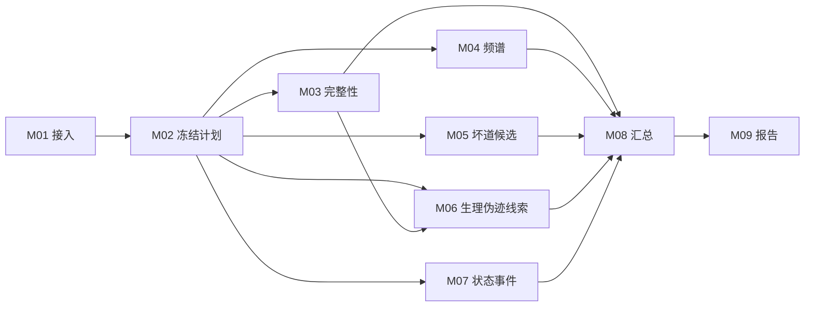

# 平台顶层流程

状态：完整目标设计，附首版执行边界。日期：2026年10月28日。首版对象：头皮 EEG。当前运行与测试范围见 [验收记录](runtime-validation.md)。

平台先描述数据，再选择适用检查，最后解释结果。疾病背景用于解释和验证分层；读取器、可测频段、参考方式、辅助导联和任务标注直接决定哪些检查能运行。疾病名称不能单独决定整条流水线或质量扣分。

## 两条相互独立的工作流程

**数据质控流程**：输入数据 → 生成检查计划 → 计算指标 → 输出候选与证据 → 人工复核。用户拿到一份数据时走这条流程。

**方法验证流程**：登记独立参考标签 → 冻结数据划分和算法参数 → 运行检测 → 对照人工标签或已知注入异常 → 记录误报、漏检及适用范围。开发者用这条流程判断模块是否可靠。

质控报告生成成功，只证明工程流程在该输入上运行完成。检测准确性和评分意义由第二条流程验证。某个检测器生成的标签不能再作为它自己的独立真值。

## 数据入口与四种对象

| 对象 | 回答的问题 | 主要内容 |
| --- | --- | --- |
| DatasetCard 数据说明 | 数据从哪里来，做了什么实验 | 来源、版本、许可、实验、采集、处理史、标签及其来源 |
| RecordingDescriptor 记录描述 | 这份文件实际包含什么 | 通道身份与类型、单位、采样率、参考、时钟、原始样本范围 |
| QCPlan 检查计划 | 本次准备检查什么以及为什么 | 模块版本、依赖、参数、运行范围、适用性决定及原因 |
| QCResult 质控结果 | 发现什么，有什么证据 | 原始指标、异常候选、已评范围、未评原因、评分版本、证据与复核 |

数据集说明和单份记录头字段分别保存；描述冲突需要保留来源，不以文件名猜测代替提供方说明。未知值显式为未知。

## 九个职责模块

| 模块 | 职责 | 对后续的作用 |
| --- | --- | --- |
| M01 | 数据接入与结构核验 | 确定可信的信号、时间轴、单位与通道身份 |
| M02 | 数据画像与检查计划 | 为各方法判断条件并冻结本次计划 |
| M03 | 信号完整性 | 检查缺失、平线、重复、削波候选与断点 |
| M04 | 频谱与干扰 | 计算可测频段的 PSD、工频、漂移及高频线索 |
| M05 | 坏通道候选 | 汇总基础指标并运行满足前提的相对或空间方法 |
| M06 | 生理伪迹线索 | 按实际辅助导联及方法前提检查眼电、心电、肌电线索 |
| M07 | 状态与事件 | 核对标注、分段和事件；提供分状态解释 |
| M08 | 汇总与可比性 | 汇总分项和覆盖，决定能否给出有意义的总分或比较 |
| M09 | 报告与复核 | 保存证据、人工决定、版本与导出结果 |

执行关系：M01 → M02 → M03/M04/M06/M07；M05按具体方法依赖M03/M04及可比较通道信息；M08汇总各分项；M09展示并保存复核。状态标注在M02已可用于规划，M07负责进一步核对。只读计算可以共享同一特征产物，避免重复计算。

每个顶层模块可以包含多个方法。首版调度器已经按职责直接调用 BrainElecQC 的独立函数，M03–M07 可选择执行。M05 的 PREP 非空间方法自行计算原始信号特征，因此当前只依赖 M02；M06 使用 M03 的连续性候选作为高频检查保护区，因此会自动补入 M03。M08 只汇总实际选择的模块，M09 生成报告。未来更换方法时，依赖应按实际计算更新。

图中并列表示职责与依赖，不表示同时抢占算力。首版在同一任务进程内依次执行，队列一次运行一个任务。未选择模块不会偷偷计算；缺条件的子方法报告未评，不自动清理原信号。

## 控制模块的规则

1. 读取器不认识格式、信号和通道无法可靠对应时，停止依赖该输入的分析，输出接入错误。
2. 单位未知时，数字结构检查仍可运行；绝对幅度阈值检查未评。
3. 缺少辅助导联、坐标、参考或足够可比较通道时，仅跳过依赖它们的方法。
4. 算法运行失败与条件不适用分别记录；失败不能显示为正常，也不能静默换算法。
5. 修改通道选择、时间范围、方法版本或参数会产生新的计划和运行记录；原结果保留。
6. 人工复核写入独立决定，不覆盖自动指标。清洗、插值和重参考是后续派生操作，保留父数据与处理记录。

## 总分与比较

先交付指标原值、分项结果、证据和已评范围。总分仅在规则、权重和比较范围确定后启用；无法形成可比较总分时返回空值并写原因。BrainElecQC 原有分数可作为带来源的后端结果保存，不直接作为我们已经验证的跨数据集评分。

比较要求同一目标场景、规则版本、可比的采集与处理条件，以及一致的评分维度和覆盖。相同疾病名称不足以满足这些条件。

## 第一版边界

先用连续 EDF 的多通道静息记录和少导联 PSG 验证入口、适用性与报告；增加带独立坏道或伪迹标注的数据验证方法。癫痫相关数据用于检查病理波形误报边界，需配套专家复核。其他格式、模态和应用评分分批验收。
