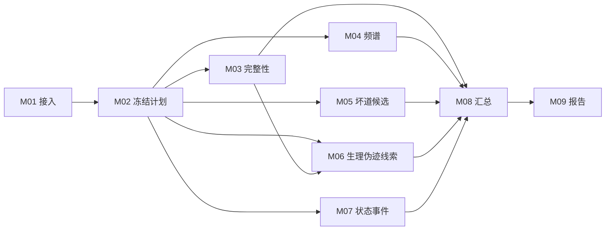

# 平台顶层流程

状态：目标架构与当前执行边界。更新：2026年10月31日。当前路线：头皮 EEG，以及 ECoG、sEEG、Neuropixels连续电压基础描述检查。当前运行与测试范围见 [验收记录](runtime-validation.md)。

[English](en/architecture.md)

平台先描述数据，再选择适用检查，最后解释结果。疾病背景用于解释和验证分层；读取器、可测频段、参考方式、辅助导联和任务标注直接决定哪些检查能运行。疾病名称不能单独决定整条流水线或质量扣分。

自1.0.0rc2起，M01–M09分别位于`src/ephys_qc/modules/`，核心通过`toolkit.py`和命令行独立使用。网站位于`apps/workbench/`，调用同一核心；网站不作为算法安装或运行的必要条件。接收方入口见[模块交接与独立调用](toolkit.md)。

## 两条相互独立的工作流程

**数据质控流程**：输入数据 → 生成检查计划 → 计算指标 → 输出候选与证据 → 人工复核。用户拿到一份数据时走这条流程。

**方法验证流程**：登记独立参考标签 → 冻结数据划分和算法参数 → 运行检测 → 对照人工标签或已知注入异常 → 记录误报、漏检及适用范围。开发者用这条流程判断模块是否可靠。

质控报告生成成功，只证明工程流程在该输入上运行完成。检测准确性和评分意义由第二条流程验证。某个检测器生成的标签不能再作为它自己的独立真值。

## 数据入口与四种对象

| 对象 | 回答的问题 | 主要内容 |
| --- | --- | --- |
| DatasetCard 数据说明 | 数据从哪里来，做了什么实验 | 来源、版本、许可、实验、采集、处理史、标签及其来源 |
| RecordingDescriptor 记录描述 | 这份文件实际包含什么 | 通道身份与类型、单位、采样率、参考、时钟、原始样本范围 |
| QCPlan 检查计划 | 本次准备检查什么以及为什么 | 模块版本、依赖、参数、运行范围、适用性决定及原因 |
| QCResult 质控结果 | 发现什么，有什么证据 | 原始指标、异常候选、已评范围、未评原因、评分版本、证据与复核 |

数据集说明和单份记录头字段分别保存；描述冲突需要保留来源，不以文件名猜测代替提供方说明。未知值显式为未知。

## 九个职责模块

### 方法目录与模态

方法工具箱按**检查目的 → 具体方法**组织。模态是每个方法的适用范围，不与检查目的混在同一级；启用方式是方法属性，也不作为顶层目录。

| 功能域 | 包含模块 | 主要问题 |
| --- | --- | --- |
| 数据与元信息 | M01、M02 | 读到了什么，信息是否足以生成计划 |
| 信号完整性 | M03 | 是否缺失、恒定、截断或有异常幅度 |
| 频谱与干扰 | M04 | 能量如何分布，是否有窄带干扰 |
| 通道质量 | M05 | 哪些通道或通道对需要复核 |
| 伪迹线索 | M06 | 是否存在眼电、心电或肌电污染的证据 |
| 事件与时间 | M07 | 标注与信号时间是否对应 |
| 结果与报告 | M08、M09 | 检查了哪些内容，结论由什么证据支持 |

上述为目录分组，不改变 M01–M09 的执行边界或依赖。事件与时间域当前仅提供已登记事件/分期在原始时间轴上的核对；多设备时钟、延迟和漂移估计尚未实现。

每个方法分别声明功能域、适用模态、启用方式、前提、参数、输入输出、来源和接入状态。“随模块运行”“满足条件”“手动扩展”仅说明选择和启用方式，不表示跨模态通用；推荐仍须逐项通过实际输入条件检查。计划中的方法不能作为可运行能力。

扩展模态时沿用功能目录，但分别建立方法适用性及验证案例。头皮 EEG、ECoG、sEEG 不能仅通过切换标签就共用参考组、空间关系或判定阈值。胞外记录还须区分连续电位（如 LFP/AP 信号）与 spike/已分选单元；后者需要独立的放电与单元质量功能域，当前未接入。Neuropixels 属于采集技术，不能替代上述数据对象声明。

推荐的目标顺序是：**文件读取 → 确认模态与数据对象 → 核对技术前提 → 选择方法及参数 → 冻结执行计划**。格式用于选择读取器；参考、频带、坐标、辅助导联和标注决定可执行项目；疾病与任务提供背景并用于后续验证分层。未来疾病专用规则须有独立依据，不能由疾病名称直接推出质量好坏。当前提供头皮EEG、`ecog-basic/1`、`seeg-basic/1`和`neuropixels-voltage/2`四条执行路线。Neuropixels接入受支持SpikeGLX探针的原始AP/LF单流，或有明确Neuropixels设备证据的NWB连续ElectricalSeries；不接入分选后的spike/unit质控。

### 当前模态路由

页面统一从文件或已登记记录进入：读取 → 提取信息 → 确认本次分析对象 → 推荐 → 执行与复核。无已确认输入时只显示共同功能框架。文件明确声明可预填模态建议，默认或推断类型仍须确认；混合记录按组选择本次范围。全部记录与历史可见，工具箱浏览不改变当前数据或计划。详见[通用流程约定](workflow-standards.md)。

`catalog(modality=...)`是内部方法目录接口；推荐、计划和执行使用已确认的同一模态声明，格式仅选择读取器。计划及结果另冻结`analysis_profile`，避免只凭M03等模块编号混用实现。当前每次计划运行一个兼容通道组，尚未实现多模态联合任务。

| 路线 | 独立计算模块 | 共享步骤 | 当前未接入 |
| --- | --- | --- | --- |
| 头皮EEG / scalp-eeg/1 | 头皮完整性、频谱、坏道及伪迹方法 | M01、M02、M07、M08、M09基础接口 | 见各方法前提 |
| ECoG / ecog-basic/1 | M03非有限与精确恒值、M04描述性PSD、M05逐触点统计 | 读取、计划、已登记事件核对、汇总、报告；保留模态语义 | 临床伪迹判定、坏触点阈值、位置关系、评分校准 |
| sEEG / seeg-basic/1 | 独立入口，M03–M05描述性数学核 | 相同流程与结果契约，参数和模态单独冻结 | 电极杆/双极推断、病理伪迹判断及评分 |
| Neuropixels 电压 / neuropixels-voltage/2 | 单流连续电压独立入口，M03–M05描述性数学核 | 单流原生时钟、读取标定、计划、汇总、报告 | 分选、单元质量、漂移、跨流同步及M06 |

ECoG默认M03–M05；有已登记事件时推荐M07。ECoG/sEEG可显式选择M06 FieldTrip差分候选，默认不启用；Neuropixels的M06仍未接入。非空头皮专属参数被拒绝，不自动迁移。独立实现位于`src/ephys_qc/modules/ecog/`，技术要求见[ECoG约定](ecog/qc-standards.md)。sEEG与Neuropixels分别使用`modules/seeg/`及`modules/neuropixels/`入口，并通过`modules/continuous/`共享有限值扫描、Welch和统计计算。共享数学核不共享头皮阈值或临床解释；具体要求见[sEEG规范](seeg/qc-standards.md)、[Neuropixels规范](neuropixels/qc-standards.md)及[多模态模块分层](multimodal-extension.md)。

Neuropixels一次计划选择一个SpikeGLX AP/LF流或NWB连续电压流。SpikeGLX按明确增益转换模拟神经通道，数字同步字独立保存且不得参与电压统计；NWB按源单位与转换字段标定，保留每个流的电极表映射及独立时钟。默认分析时段受原生采样率、选道数和256MiB读取预算限制，不通过降采样掩盖超预算。型号0已有真实NP1读回核验；型号21/24（NP2）目前仅有合成读取测试，不宣称真实NP2数据验证。unit身份、spike时间、分选器版本及依赖原始波形的单元质量指标属于后续独立层，不能从原始RMS推导unit SNR。

### 头皮EEG执行职责

| 模块 | 职责 | 对后续的作用 |
| --- | --- | --- |
| M01 | 数据接入与结构核验 | 确定可信的信号、时间轴、单位与通道身份 |
| M02 | 数据画像与检查计划 | 为各方法判断条件并冻结本次计划 |
| M03 | 信号完整性 | 检查缺失、平线、重复、削波候选与断点 |
| M04 | 频谱与干扰 | 计算可测频段的 PSD、工频、漂移及高频线索 |
| M05 | 坏通道候选 | 汇总基础指标并运行满足前提的相对或空间方法 |
| M06 | 生理伪迹线索 | 按实际辅助导联及方法前提检查眼电、心电、肌电线索 |
| M07 | 状态与事件 | 核对标注、分段和事件；提供分状态解释 |
| M08 | 汇总与可比性 | 汇总分项和覆盖，决定能否给出有意义的总分或比较 |
| M09 | 报告与复核 | 保存证据、人工决定、版本与导出结果 |

当前执行关系：M01 → M02；M03、M04、M05、M07依赖M02，M06还依赖M03的连续性候选。M05当前自行计算所需分项，不依赖M04的频谱产物。M08汇总实际结果，M09生成报告；工作台另存版本化人工意见。状态标注可用于规划背景，M07负责进一步核对。后续共享特征或新增依赖须显式更新执行计划，不能仅根据图示推断。

每个顶层模块可以包含多个方法。首版调度器已经按职责直接调用 BrainElecQC 的独立函数，M03–M07 可选择执行。M05 的 PREP 非空间方法自行计算原始信号特征，因此当前只依赖 M02；M06 使用 M03 的连续性候选作为高频检查保护区，因此会自动补入 M03。M08 只汇总实际选择的模块，M09 生成报告。未来更换方法时，依赖应按实际计算更新。

图中并列表示职责与依赖，不表示同时抢占算力。首版在同一任务进程内依次执行，队列一次运行一个任务。未选择模块不会偷偷计算；缺条件的子方法报告未评，不自动清理原信号。

## 控制模块的规则

1. 读取器不认识格式、信号和通道无法可靠对应时，停止依赖该输入的分析，输出接入错误。
2. 单位未知时，数字结构检查仍可运行；绝对幅度阈值检查未评。
3. 缺少辅助导联、坐标、参考或足够可比较通道时，仅跳过依赖它们的方法。
4. 算法运行失败与条件不适用分别记录；失败不能显示为正常，也不能静默换算法。
5. 修改通道选择、时间范围、方法版本或参数会产生新的计划和运行记录；原结果保留。
6. 人工复核写入独立决定，不覆盖自动指标。清洗、插值和重参考是后续派生操作，保留父数据与处理记录。

## 总分与比较

先交付指标原值、分项结果、证据和已评范围。总分仅在规则、权重和比较范围确定后启用；无法形成可比较总分时返回空值并写原因。BrainElecQC 原有分数可作为带来源的后端结果保存，不直接作为我们已经验证的跨数据集评分。

比较要求同一目标场景、规则版本、可比的采集与处理条件，以及一致的评分维度和覆盖。相同疾病名称不足以满足这些条件。

## 第一版边界

当前读取范围覆盖 EDF/EDF+、BDF、BrainVision、连续 EEGLAB、单文件 FIF、NWB 2/HDF5连续ElectricalSeries，以及受支持Neuropixels型号的SpikeGLX原始AP/LF配套文件；代表性真实记录及其报告覆盖见[数据验收](data-validation.md)。质量标签对齐和检测准确性仍须独立验证。癫痫相关数据用于检查病理波形误报边界，需配套专家复核。当前sEEG与Neuropixels基础测量不赋予病理或单元质量结论；其他记录系统、信号层级和应用评分分批验收。来源一致的真实样例、明确派生片段、合成边界及来源失败负例分开计数，详见[多模态数据范围](multimodal-extension.md)。

### NWB接入（1.0.0rc3.dev4）

NWB是文件容器，不是第五种模态。读取器发现多个ElectricalSeries后，由使用者明确选择；对象路径、通道映射、时钟和来源指纹随输入版本与计划冻结。相同文件中的Units独立登记其存在，不增加波形通道数，不触发单元质控。EEG/ECoG/sEEG的选择仍需来源支持，Neuropixels另须可信设备证据。不同流不自动拼接、重采样或跨时钟校准。旧`neuropixels-raw/1`任务按原冻结配置解释，现行`neuropixels-voltage/2`不覆盖历史结果。来源与测试范围见[NWB样例](nwb-testing.md)。
