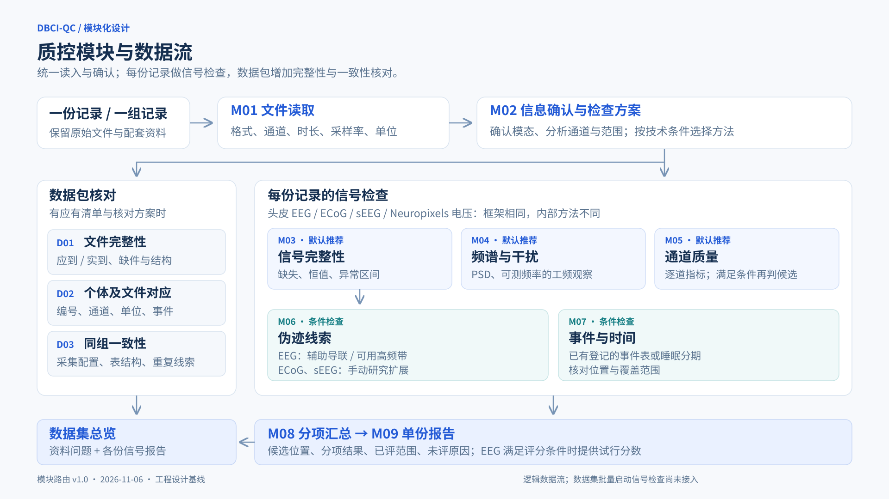
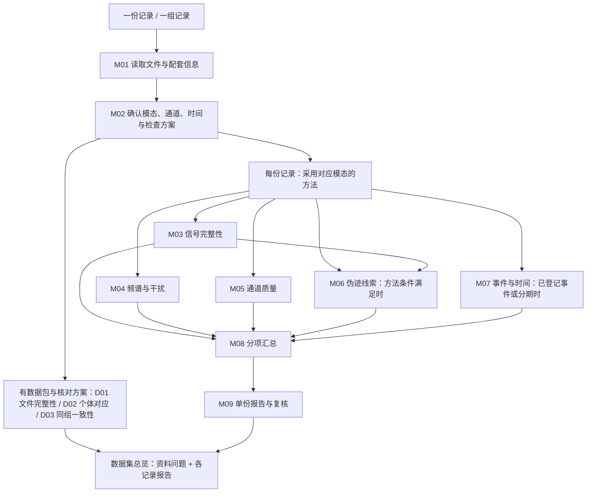

# 质控模块与启用规则 v1.0

固定日期：2026-11-06。用途：模块交接、下周展示及后续开发基线。

**统一读入，确认数据，再按条件检查。模块按检查目的划分，模态决定模块里的方法。**

本版固定模块职责和启用条件，沿用当前推荐器，不新增算法或改变评分公式。它是工程设计基线，不是已审核的临床质量标准。EEG 先形成完整的检查—报告流程；其他模态先提供基础电压描述。

## 1. 展示导图

- [矢量导图](figures/module-routing-v1.svg)：适合放入 PPT，放大不失真。
- [数据条件与启用方法](figures/module-conditions-v1.png)：回答每类数据具体运行什么。
- [规划复验记录](../validation/module-routing-20261106.md)：当前代码与登记样例的核对结果。

导图表达产品数据流。实际执行中 M03/M04/M05/M07 分别依赖 M02；M06 还依赖 M03；M05 不依赖 M04 的 PSD 输出。数据集 D01–D03 有独立入口，聚合层关联已有单份报告；目前不会因登记数据集而自动启动全部信号任务。

## 2. 固定的三层启用规则

| 层级 | 启用方式 | 包含内容 |
| --- | --- | --- |
| 共同步骤 | 每次信号任务执行 | M01 读取、M02 确认与计划、M08 汇总、M09 报告 |
| 基础检查 | 推荐方案默认选择，内部方法逐项核对条件 | M03 完整性、M04 频谱与干扰、M05 通道质量 |
| 条件检查与研究扩展 | 条件满足后推荐；研究扩展另外显式选择 | M06、M07；LOF、FASTER、FieldTrip、SpikeInterface 等扩展 |

“默认推荐”不代表全部子方法都可运行，也不代表禁止专业用户调整方案。计划、条件、参数及版本随本次结果保存。

### 2.1 信号模块

| 模块 | 何时使用 | 本版输出 | 条件不足时 |
| --- | --- | --- | --- |
| M01 文件读取 | 每份记录；按格式调用读取器 | 通道、单位、采样率、时长、流/标注信息、来源指纹 | 缺配套文件或不可读时保留接入问题；阻止依赖该信号的任务 |
| M02 信息确认与方案 | 读取后；确认分析模态、选道、流和时间范围 | 一份冻结的检查计划 | 单位/模态/通道身份无法确认时先补全；背景字段可未知 |
| M03 信号完整性 | 所有已确认、可标定的连续电压记录，默认推荐 | 非有限值、恒值等位置；头皮 EEG 可核对标定端点平台 | 缺 ADC 端点仅不判端点平台；其他检查保留 |
| M04 频谱与干扰 | 所有连续电压记录，默认推荐 | PSD；头皮 EEG 的可测工频候选与谱拟合；其他模态的窄带观察量 | 分别核对时长和可测频率；没有测到不等于没有问题 |
| M05 通道质量 | 所有连续电压记录，默认推荐 | EEG 的 PREP 非空间分项与候选；其他模态逐触点幅度/离散程度等统计 | EEG 比较组缺失或太小时保留描述量，不启用该组相对判坏 |
| M06 伪迹线索 | EEG：至少一种 ECG/EOG/高频方法满足条件；ECoG/sEEG 仅显式选 FieldTrip 扩展 | 辅助导联锁时证据、高频候选，或选定扩展的候选区间 | 仅不执行缺条件的子方法；没有 EMG 的高频候选不确认为肌电 |
| M07 事件与时间 | 已登记本系统支持的任务事件、睡眠分期或临床事件表 | 原始时间定位、阶段覆盖及选区事件 | 没有登记表则默认不推荐；文件内一条 annotation 不自动视为可用任务表 |
| M08 分项汇总 | 每次信号任务 | 已评项目、候选、覆盖范围、未评原因；EEG 另有版本化试行评分 | 缺评分必要证据时总分留空，已有分项和报告保留 |
| M09 报告与复核 | 每次信号任务结束后 | 单份 HTML、证据与波形；工作台提供 PDF 和人工意见 | 问题、未评和失败分开列；不自动删道、删段或清洗原件 |

**单位未知的记录可以保留文件/元数据核对结果；当前信号任务入口要求选中信号具备可核验的电压单位，不会自动猜测单位后继续分析。**

### 2.2 数据集模块

| 模块 | 何时使用 | 本版输出 | 不满足条件时 |
| --- | --- | --- | --- |
| D01 文件完整性 | 数据包已登记独立的应有清单 | 应到/实到、缺件、大小/指纹、文件结构问题 | 只有当前文件列表，不能证明应有资料齐全 |
| D02 个体及文件对应 | 有明确受试者、会话、记录和配套文件映射 | 编号、通道、单位、采样率、时长及事件对应问题 | 配套表缺失只标相应项目未评；不能据此鉴定真实身份 |
| D02 个体内重复记录 | 同一受试者、会话和比较组至少两份记录 | 个体内通道/单位/采样率/参考差异 | 只有一份记录，不做重复记录一致性结论 |
| D03 数据集一致性 | 已明确比较组及需要一致的字段；组内有可比较记录 | 同组配置、表结构差异及重复文件线索 | 不同模态、原始/派生混组时停止该组比较；不由多数数据推定正确值 |

不同患者的 ECoG/sEEG 可有不同植入位置和通道数，跨患者组不能默认要求电极布局一致。是否要求通道、采样率、单位和参考相同，由该比较组的四项显式开关确定，见[数据集检查规则](../dataset-checks.md)。

## 3. 什么数据走什么检查

| 输入 | 默认信号路线 | 条件增加项 | 本版结果 |
| --- | --- | --- | --- |
| 人类连续头皮 EEG | M03 完整性 + M04 PSD/工频 + M05 PREP 非空间分项 | 有可用高频带或已确认 ECG/EOG → M06；有已登记事件/分期 → M07 | 问题定位、通道候选、分项；三项证据齐全时显示 EEG 试行总分 |
| 连续 ECoG | M03 完整性 + M04 描述性频谱 + M05 逐触点统计 | 已登记事件 → M07；手动扩展 → FieldTrip | 基础测量和候选；不使用头皮判坏阈值，不提供 EEG 总分 |
| 连续 sEEG | 与 ECoG 共享基础计算，模态和参数单独保存 | 同上；不从通道名称推断电极杆或邻接 | 基础测量和候选；病理放电不直接作为伪迹 |
| Neuropixels 连续 AP/LF 电压 | M03 完整性 + M04 描述性频谱 + M05 逐通道统计 | AP 且 shank 分组满足条件 → 可手动增加 SpikeInterface MAD/STD；已登记事件 → M07 | 电压层报告；不含分选单元、漂移或跨流同步质量 |
| 多份记录组成的数据集 | 每份记录仍采用以上对应路线 | 明确清单/映射/比较组后增加 D01–D03 | 按个体与记录汇总资料问题，并关联单份信号报告；不平均各模态分数 |

EDF/EDF+、BDF、BrainVision、连续 EEGLAB、单文件 FIF、NWB 2/HDF5 连续 ElectricalSeries 由对应读取器处理。SpikeGLX 当前用于受支持 Neuropixels 探针的 AP/LF 配套文件。**格式选择读取器，不能单凭扩展名确定模态。**

NWB 先明确选择信号流；Neuropixels 还需明确设备及电极映射证据。一个计划对应一个兼容信号组和原生时钟；混合记录分别确认分析组，不把所有通道一起套进 EEG 流程。NWB 的 Units 表、spike sorting 结果及其他物种的专用质量规则，不列为本版已验证路线。

## 4. 方法级触发条件

以下为当前实现条件，数值不是已认可的行业合格线。源码中的参数核验及逐窗执行结果为最终依据。

| 条件 | 采用的方法 | 条件不足的结果 |
| --- | --- | --- |
| EEG；比较组有来源依据，组内默认至少 4 道 | M05 PREP 非空间相对异常检查 | 描述量仍保留，该组不做相对阈值判坏 |
| EEG；选中了 ECG/EOG，采样时钟与分析信号相容 | M06 对应的 ECG/EOG 锁时检查 | 不凭通道名称、疾病或普通 EEG 波形补造辅助导联 |
| EEG；窗口至少 10 秒，默认有效高频带宽满足 `min(100, 0.45×fs) − 30 ≥ 20 Hz` | M06 高频突发 | 频带或时长不足不执行；无 EMG 只报告高频线索 |
| 目标工频及邻域可测，足够的完整分析窗口 | M04 工频检测；逐频率、逐窗核验 | 越界频率/短尾窗未评；频谱图仍可保留 |
| 已明确登记 `sleep_stages_tsv`、`bids_events_tsv` 或 `clinical_events_tsv` 及路径 | M07 对应一种时间核对 | 仅有“睡眠/任务/癫痫”标签不启用；格式名称不代表完整 BIDS 验证 |
| EEG；共同/连接耳参考；单一明确比较组；至少 8 道和 10 秒；满足各方法附加门槛 | 手动选 M05 MNE bridge / LOF | 不自动重参考、不自动扩大比较组；LOF 还要求通道数大于邻居数 |
| EEG；足够固定窗口，默认至少 20 个完整的 2 秒段 | 手动选 M03 AutoReject 全局阈值 | 不把固定段当真实任务试次；不是 local AutoReject |
| EEG；已核对频带；采样率支持 110–140 Hz，至少 10 秒 | 手动选 M06 MNE 高频包络 | 已知滤波截去目标频带则不启用；未知滤波史只保留探索线索 |
| EEG；8–128 道、同参考组及足够固定段/采样率 | 手动选 M05 FASTER | 仅当前坏道接口，不声称运行了完整 FASTER 清洗流程 |
| EEG/ECoG/sEEG；至少 10 秒；外部运行环境已安装 | 手动选 M06 FieldTrip 差分 z 值 | 输出差分异常候选，不确认生理伪迹来源 |
| Neuropixels AP；源文件明确 shank；每组至少 8 道及足够采样范围 | 手动选 M05 SpikeInterface MAD/STD | LF 不套用 AP 方法；缺 shank 不猜测分组 |
| 显式选择清洗效果研究，满足频率/参考/校准等各项条件 | CleanLine / Zapline-plus / ASR 副本评估 | 默认关闭；不改原件、不纳入当前质量分；ASR 整记录模式不支持 |

MNE 差分平线是当前 EEG 推荐中的默认增强（默认 flat=0、peak 未启用）。空间 RANSAC、local AutoReject、ICA/ICLabel 仍待接入，不能在展示中计为可运行模块。完整扩展条件见[研究方法运行规范](../optional-methods-runtime.md)和[方法适用规则](../method-applicability.md)。

## 5. 背景标签与评分的固定边界

- **疾病、年龄、任务**用于解释与后续分层验证，本版不凭这些标签修改阈值，也不另建“癫痫质控”“睡眠质控”整套流水线。是否有具体事件/分期文件，则直接决定 M07 是否推荐。
- **参考和比较组**直接影响相对坏道检查；**采样率、时长、滤波史**影响方法能测什么；**辅助导联**决定对应锁时方法是否可用。每个方法只读取自己需要的字段。
- **预处理史**必须随结果解释。已陷波的工频高分不证明原始采集质量好，处理过的数据和原始记录不能仅按同一个分数比较。目前不是所有基础方法都已把滤波史实现为自动禁用条件；不能在导图中声称已经具备这一保护。
- **评分是报告层的独立规则**：当前只有 EEG 完整性、工频、高频突发参与 `eeg-basic-screen/0.2`；M05 PREP、PSD 图和研究扩展不自动计分。核心原始结果与报告层试行分数分开保存，见[评分规则](../eeg-scoring.md)。
- **条件不足不是质量差**。模块可产生有效的部分结果；报告按方法列“做了什么、没做什么、检出了什么”，不能只给整块“受限”。本文件明确该展示原则；现有工作台的部分模块仍有“条件受限”汇总标签，后续界面须与此对齐。

## 6. 下周演示顺序

| 场景 | 本地已有样例 | 应展示的差别 |
| --- | --- | --- |
| 普通 EEG | EEGMMIDB S001R01 | 基础检查 + 可测高频线索；没有 ECG/EOG 时相关检查不运行 |
| 有辅助导联与分期的 EEG | HMC SN062 | 增加 ECG/EOG 锁时线索和 M07 睡眠分期；对比普通 EEG |
| 通道少、采样率低的睡眠 EEG | Sleep-EDF SC4001 | EOG 和分期仍可用；高频带不足时不做高频突发，不强行给完整总分 |
| 侵入式电压 | 已登记 MNE ECoG / sEEG 示例 | 模块框架相同，内部换基础描述方法，不套头皮评分 |
| Neuropixels | 已登记 NP1 AP / LF 片段 | 分别选择 AP/LF 单流；基线报告只描述电压质量 |
| 数据集 | ds002034 双个体演示包 | D01–D03 资料核对 + 两份整时长信号报告；一人仅一条记录，不演示个体内重复记录 |

31 条已登记记录的推荐结果已按本版规则复验：这是元信息路由核对，不是 31 份新的全量 QC，也不代表 31 个独立数据源。实际已完成的双个体整份报告见[演示验收](../validation/demo-reports-20261106.md)。

## 7. 交接与后续变化

交接对象是读取器、方法适用规则、M01–M09、D01–D03 及其输入输出契约；网页展示和未来 Linxi 适配调用同一模块。下一步只在该框架里增加方法及其验收数据，不按每个新数据集另写一条临时流水线。

新增方法应登记：模块归属、适用模态、必需字段、触发条件、不满足时的行为、参数/版本、输出证据、是否参与评分、至少一个通过样例与一个条件不足样例。疾病专用阈值、跨模态总分和自动清洗不在本次固定范围。

本版实施对齐项：模块状态按子方法解释；基础方法统一核对滤波史；数据集批量信号调度。它们不影响既有单份推荐与报告演示，也不作为本次已完成能力。

实现依据：[推荐器](../../src/ephys_qc/recommendations.py)、[模态路由](../../src/ephys_qc/modalities.py)、[方法条件](../../src/ephys_qc/method_registry.py)、[执行依赖](../../src/ephys_qc/planning.py)、[数据集检查](../dataset-checks.md)。与[平台顶层设计](platform-v1.md)配套。
