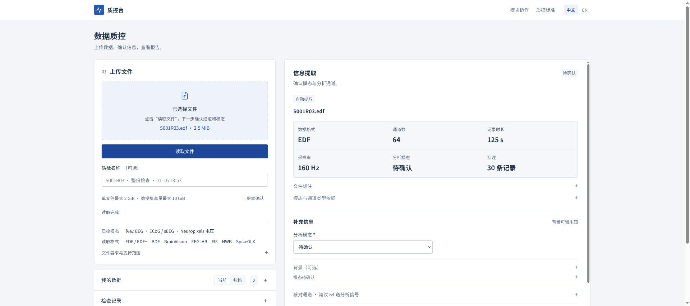
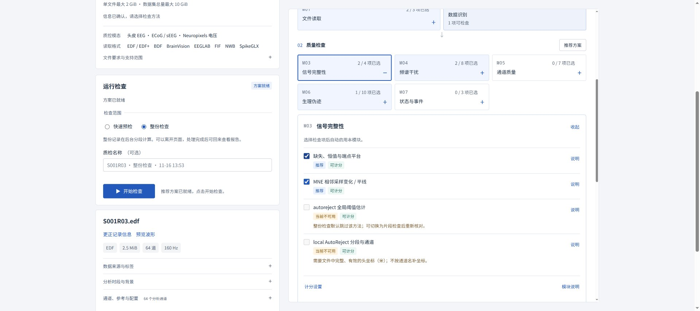
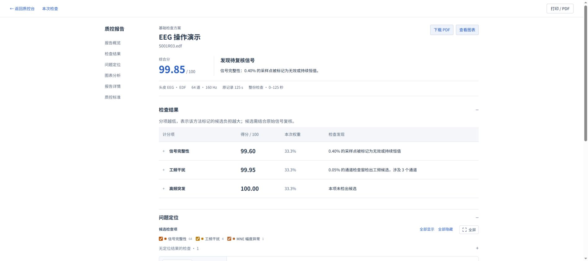
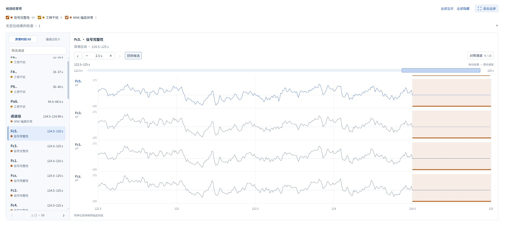

# DBCI-QC 演示素材交接

**用途：请 Pro 重新安排演示主线、PPT 和动态分镜。不是沿用上一版继续润色。**

[打包下载](../DBCI-QC-demo-assets-20261117.zip) · [复制提示词](PROMPT.txt) · [已核对事实与限制](FACTS.md) · [完整素材索引](ASSETS.json)

## 先看这些

- **F03**：文件读进来会得到什么信息。
- **F06 / F07**：子方法选择与计分权重。
- **F08**：同一文件的报告和分项。
- **F11**：最清楚的结果证据，末尾 0.5 秒的多通道恒值。
- **F12–F14**：公开示例、数据集总览、单份报告。

## 文件组织

| 目录/文件 | 用途 |
|---|---|
| screenshots/ | 16 张真实界面关键截图，编号 F01–F16 |
| raw-clips/ | 13 段无字幕、无运镜、无模拟操作的真实录制，编号 V01–V13 |
| ASSETS.json | 每段时长、点击时间、坐标、说明和校验值 |
| template/meeting-template.pptx | 用户原会议模板。封面用蓝色顶底，普通页用左上角小蓝标 |
| reference/ | 已否定的旧演示，仅作反例，不应继承其排版与节奏 |
| FACTS.md | 可引用的数据、分数、来源和不能夸大的限制 |
| PROMPT.txt | 可直接发给 ChatGPT Pro 的任务说明 |

以 2026-11-16 的真实录制为依据。截图可直接用来规划，视频用于后续剪辑；不能播放视频时，请说明并按截图与索引工作。

## 约束

- 不要求把所有素材都塞进演示。优先取舍，建议 5–6 页以内，主动态约 30–45 秒。
- 不使用汇报人姓名。标题用简短陈述句。
- 不修改截图中的结果，不生成假的波形或控件，不把项目试行评分说成通用医学标准。
- 主分支和部署代码不在本次修改范围，素材单独保存在 presentation/demo-assets-20261117 分支。
